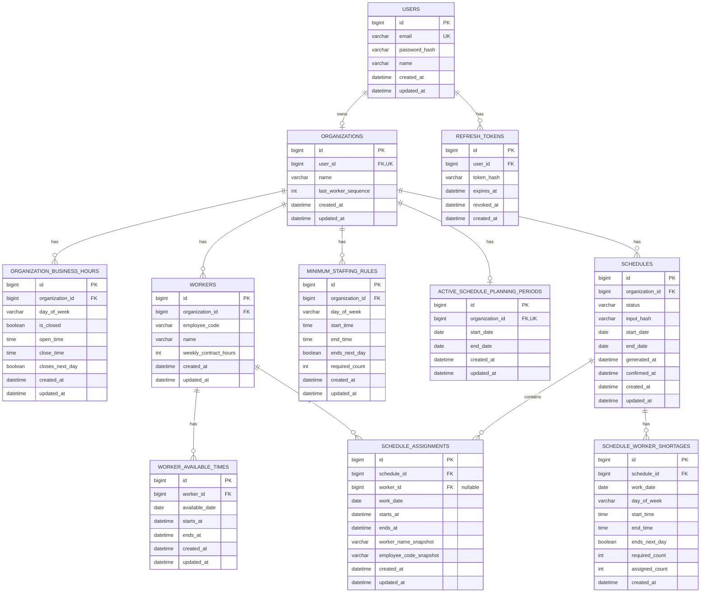

# ERD

이 문서는 프래그먼트 MVP의 데이터 모델 기준입니다. Mermaid ERD는 논리 모델을 표현합니다.
PK/FK/unique/index/enum/relation 등 구조 제약은 Prisma schema에서 관리하고, 값 범위·날짜/시간 순서·도메인 규칙은 shared Zod schema와 API service에서 검증합니다.

## Diagram

## Enums

### DayOfWeek

- `MONDAY`
- `TUESDAY`
- `WEDNESDAY`
- `THURSDAY`
- `FRIDAY`
- `SATURDAY`
- `SUNDAY`

### ScheduleStatus

- `DRAFT`
- `CONFIRMED`

## Constraints

### Prisma / DB Schema

- `USERS.email`은 전체 서비스에서 고유합니다.
- `ORGANIZATIONS.user_id`는 고유합니다. MVP에서는 계정 1개가 조직 1개만 가집니다.
- `ACTIVE_SCHEDULE_PLANNING_PERIODS.organization_id`는 고유합니다. 조직은 현재 진행 중인 스케줄링 기간을 최대 1개만 가집니다.
- `ORGANIZATION_BUSINESS_HOURS`는 `organization_id + day_of_week` 조합이 고유합니다.
- `WORKERS`는 `organization_id + employee_code` 조합이 고유합니다.
- `DayOfWeek`, `ScheduleStatus`는 enum으로 관리합니다.
- FK 관계와 cascade/set null/restrict 정책은 Prisma schema에서 관리합니다.
- 인력 삭제 시 `WORKER_AVAILABLE_TIMES`는 함께 삭제됩니다.
- 인력 삭제 시 `SCHEDULE_ASSIGNMENTS.worker_id`는 `NULL`로 처리됩니다. 배정 기록 자체는 보존됩니다.

### Zod / API Service Validation

- `SCHEDULES.input_hash`는 같은 입력 조건의 DRAFT 중복 판단에 사용하는 값입니다. MVP에서는 `organization_id + status(DRAFT) + start_date + end_date + input_hash` 중복 여부를 API service에서 확인합니다.
- `start_date <= end_date`여야 합니다.
- `starts_at < ends_at`이어야 합니다.
- `weekly_contract_hours >= 1`이어야 합니다.
- `required_count >= 1`이어야 합니다.
- 운영 시간과 최소 인원 조건의 시작 시간과 종료 시간이 같으면 저장할 수 없습니다.
- 운영 시간과 최소 인원 조건에서 종료 시간이 다음 날로 넘어가면 `closes_next_day` 또는 `ends_next_day`가 `true`입니다.
- `is_closed = true`인 운영 요일은 `open_time`, `close_time`을 비워둘 수 있습니다.
- 휴무일에는 가능 시간을 저장할 수 없습니다.
- 가능 시간은 조직 운영 시간 기준 30분 단위여야 합니다.
- 삭제된 인력은 추천 생성 기준에서 제외합니다.

### Application Read / Export Rules

- `available_date`와 `work_date`는 업무 기준일입니다.
- `starts_at`과 `ends_at`은 실제 시간 범위입니다.
- 확정 스케줄 export와 보관함 조회는 `worker_name_snapshot`, `employee_code_snapshot`을 사용합니다.
